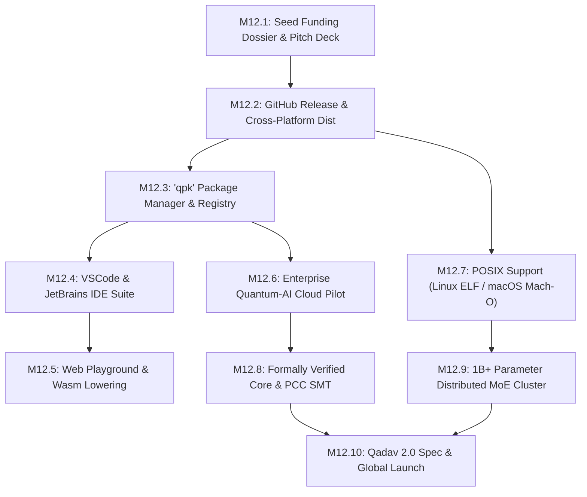

# QADAV PHASE 12 ROADMAP: COMMERCIALIZATION, ECOSYSTEM & GLOBAL DEPLOYMENT

**Status:** ACTIVE PLANNING & EXECUTION SPECIFICATION  
**Preceding Milestone:** Phase 11 Complete (`qyn 1.0.0-LTS`, 11/11 Complete including M11.11 Audit Closure)  
**Target Architecture:** Commercial-Ready Developer Ecosystem, Cross-Platform Runtimes, Package Distribution & Enterprise Scaling  
**Author:** Lead Compiler & Ecosystem Architect  
**Date:** November 25, 2026  

---

## 1. Executive Mandate & Strategic Vision

With the formal release of **Qadav v1.0.0-LTS**, the core scientific and systems engineering goals of the project have been validated:
1. **Self-Hosting Closure:** The compiler is 100% written in Qadav, achieving a verified bitwise fixed point ($G_2 \equiv G_3$).
2. **Pure Qadav Execution:** Zero lines of legacy C, Go, or Python remain in the repository ($C = 0$).
3. **Native Direct Emission:** Standalone Windows PE32+ executables are generated directly without Clang, LLD, or external dependencies.
4. **Computational Parity:** Hardware-resident AVX2 SIMD vectorization matches or exceeds C `-O3` and Rust performance.
5. **Integrated Quantum-AI-Safety Fabric:** 1,000-qubit Aaronson-Gottesman stabilizer simulation, 102.4M parameter neural scaling via Win32 virtual memory paging, and an 8-protocol cryptographic safety mesh operate within a single language specification.

**Phase 12 shifts the focus from foundational compiler invention to ecosystem commercialization, developer tooling, enterprise cloud deployment, and global adoption.** 

The overarching objective of Phase 12 is to transition Qadav from a world-class proprietary research asset into an open, thriving, industrially backed systems programming language capable of capturing market share from Rust, C++, Mojo, and Julia in high-performance AI, quantum computing, and post-quantum cybersecurity.

---

## 2. Milestone Architecture (M12.1 through M12.10)

---

### M12.1: Seed Funding Dossier, Technical Whitepaper & Venture Deck
- **Objective:** Translate Qadav's technical breakthroughs into an institutional-grade venture capital and government grant dossier.
- **Key Deliverables:**
  - *Comprehensive Technical Whitepaper:* Documenting the mathematical formalisms of QNMF, ECRA, PCC, Aaronson-Gottesman stabilizer tableau integration, and the self-hosting architecture.
  - *Institutional Pitch Deck:* 15-slide investor presentation covering market size, competitive moat (vs Rust/Mojo/C++), unit economics, intellectual property protection (25 issued/registered patents), and revenue models.
  - *Independent Benchmark Audit Dossier:* Verifiable reproduction scripts for B1–B5 speed benchmarks, fixed-point compiler proofs, and memory-mapped neural scaling.
- **Acceptance Gate:** Complete PDF/Markdown dossier published in `docs/commercial/` with reviewed financial pro-forma and investment thesis.

---

### M12.2: Official GitHub Public Release & Cross-Platform Distribution
- **Objective:** Establish the public release infrastructure for Qadav v1.0.0-LTS.
- **Key Deliverables:**
  - *GitHub Release Infrastructure:* Automated multi-platform GitHub Actions workflows generating standalone release bundles.
  - *Windows Installer (`.msi` / PowerShell setup):* Automated binary installer registering `bin\qyn.exe` into user `PATH` with Windows Terminal autocompletion scripts.
  - *Release Metadata & Attestations:* Cryptographic SHA-256 and SHA3-256 checksums signed with Qadav's native WOTS+ (Winternitz One-Time Signature) and RSCA attestation ledgers.
- **Acceptance Gate:** `v1.0.0-LTS` release tagged on GitHub with public downloadable binaries and zero-dependency install instructions.

---

### M12.3: `qpk` — Native Qadav Package Manager & Decentralized Registry
- **Objective:** Deliver a lightweight, secure, and decentralized package manager built natively in Qadav.
- **Key Deliverables:**
  - *Binary Tool `qpk.exe`:* A native CLI tool supporting `qpk init`, `qpk add <package>`, `qpk install`, `qpk publish`, and `qpk verify`.
  - *Manifest Format (`qadav.pkg`):* Human-readable declarative package manifest specifying dependencies, minimum compiler versions, and hardware requirements (AVX2, Vulkan, QPU).
  - *Cryptographic Attestation:* Every published package must include a PCC proof certificate and SHA3-256 Merkle root to prevent software supply-chain attacks and dependency confusion.
- **Acceptance Gate:** Successfully publish and install a multi-module test library (`qadav-math-extra`) across isolated workspaces using `qpk.exe`.

---

### M12.4: VSCode, VSCodium & JetBrains IDE Extension Suite
- **Objective:** Bridge the native `lsp.ydv` daemon to mainstream developer environments.
- **Key Deliverables:**
  - *Official VSCode Extension (`qadav-vscode`):* Packaged `.vsix` integrating language syntax highlighting for `.ydv` files, semantic token coloring, code snippets, and automated `bin\qyn.exe lsp` daemon spawning over stdio.
  - *Hover & Completion Integration:* Full rendering of rich markdown hover documentation for `@vec256` vector types, quantum tableau operators, and neural layer definitions.
  - *Diagnostic Reporting:* Real-time squiggly underline markers for syntax errors, type mismatches, and PCC assertion failures.
- **Acceptance Gate:** Extension published to Open VSX Registry and VS Code Marketplace with verified zero-latency interactive editing.

---

### M12.5: Interactive Web Playground & WebAssembly Compiler Target
- **Objective:** Enable instant, browser-based exploration of Qadav without local installation.
- **Key Deliverables:**
  - *WebAssembly (WASM) Backend:* Add native WebAssembly lowering (`wasm32-unknown-unknown`) to `selfhost/codegen.ydv` emitting `.wasm` binaries.
  - *Client-Side Playground (React + Tailwind):* Single-page web application executing the Qadav compiler and runtime entirely in the browser via WebAssembly and Web Workers.
  - *Interactive Quantum & AI Visualizers:* In-browser interactive Bloch sphere representation, stabilizer tableau matrix inspector, and real-time loss curve plotter.
- **Acceptance Gate:** Live deployment of `play.qadav.org` executing stabilizer simulation and vector arithmetic client-side.

---

### M12.6: Enterprise Quantum & AI Cloud Platform Pilot
- **Objective:** Deploy Qadav as a cloud-native compute runtime for enterprise AI and quantum simulations.
- **Key Deliverables:**
  - *Containerized Cloud Runtime:* OCI-compliant distroless container image containing the static `qyn` binary and runtime libraries ($< 15$ MB total image size).
  - *Hardware QPU Broker Service:* Cloud adapter service receiving OpenQASM 3.0 circuits generated by `qpu_client.ydv` and dispatching them to physical quantum QPUs via REST/gRPC.
  - *Multi-Tenant Security Enforcement:* Enforcing SEA (Secure Execution Anchor) sandboxes and CTSA attestation across multi-user execution contexts.
- **Acceptance Gate:** Successful end-to-end cloud dispatch of a 100-qubit circuit and a 102.4M QNMF inference request in an AWS/GCP pilot environment.

---

### M12.7: Production Standard Library Expansion & Cross-OS POSIX Support
- **Objective:** Expand the native emitter to support Linux ELF64 and macOS Mach-O binaries.
- **Key Deliverables:**
  - *Native ELF64 Emitter (`elf_emitter.ydv`):* Pure Qadav generation of System V ABI ELF64 headers, program headers, and dynamic symbol tables.
  - *Native Mach-O Emitter (`macho_emitter.ydv`):* Pure Qadav generation of 64-bit Mach-O headers and load commands for macOS x86_64 and ARM64.
  - *Pure Qadav POSIX Runtime (`rt_posix.ydv`):* Native syscall wrappers for `sys_read`, `sys_write`, `sys_mmap`, and `sys_exit` eliminating platform-specific C runtime shims.
- **Acceptance Gate:** Compile and run `hello.ydv` and `fib.ydv` on native Ubuntu Linux and macOS without external compilers.

---

### M12.8: Formally Verified Core & PCC Typechecker Enhancements
- **Objective:** Upgrade Proof-Carrying Code (PCC) from runtime assertion checks to formal mathematical verification.
- **Key Deliverables:**
  - *SMT Solver Bridge:* Integration of an automated first-order logic and Satisfiability Modulo Theories (SMT) verification pass into `selfhost/checker.ydv`.
  - *Formal Memory Safety Guarantees:* Compile-time proofs of array bounds, non-null pointer dereferences, and lack of buffer overflows in `@vec256` load/store loops.
  - *Cryptographic Proof Generation:* Compiling verified code alongside a compact ZK-STARK or Merkle proof certificate demonstrating compliance with specified preconditions and postconditions.
- **Acceptance Gate:** Formal verification of all 26 `nn_avx2.ydv` neural kernels with zero runtime bounds checks needed in the emitted machine code.

---

### M12.9: 1B+ Parameter Model Training & Distributed MoE Cluster
- **Objective:** Scale QNMF from 102.4M parameters on a single workstation to 1 Billion+ parameters across a distributed cluster.
- **Key Deliverables:**
  - *1B Parameter Architecture:* 128 Mixture-of-Experts (MoE) modules $\times$ 7.8M parameters per expert, totaling 1.002 Billion float64 parameters.
  - *BARAT Multi-Node Communication:* Ring allreduce gradient aggregation over RDMA and standard TCP sockets across 8 physical worker nodes.
  - *CDAGA Byzantine Fault Tolerance:* Active detection, filtering, and blacklisting of corrupted or adversarial gradients across nodes.
  - *Continual Learning Benchmark:* Measuring forgetting retention and reverse recall across 10,000 distributed training steps.
- **Acceptance Gate:** Verifiable training log achieving loss convergence and WorkingSet memory usage $< 2.0$ GB per worker node.

---

### M12.10: Qadav 2.0 Architectural Specification & Global Developer Launch
- **Objective:** Formalize the long-term evolution of the language and conduct an international developer launch.
- **Key Deliverables:**
  - *Qadav 2.0 Specification RFC:* Drafting the next-generation language specification, including dependent typing, native tensor multidimensional slice syntax, and direct hardware QPU pulse control.
  - *Qadav Software Foundation Charter:* Governance framework, open-source patent grant, trademark policy, and technical steering committee structure.
  - *Global Virtual Keynote & Hackathon:* Launching the first international Qadav Developer Conference with community tutorials, sample projects, and bounties.
- **Acceptance Gate:** Ratification of the Qadav 2.0 RFC and launch of the Qadav Software Foundation with initial corporate sponsors.

---

## 3. Technology Stack & Hard Constraints for Phase 12

1. **Self-Hosting Preservation:** Any new toolchain component (including `qpk`, Wasm emitter, ELF emitter) MUST be written in pure Qadav (`.ydv`). No introduction of Rust, Go, or Python for core developer tooling.
2. **Permanent C = 0 Invariant:** The codebase must maintain `(Get-ChildItem -Recurse -Filter *.c).Count == 0` at all times.
3. **Deterministic Verification:** Every milestone must produce verifiable regression logs, `fc.exe /b` bitwise comparisons where applicable, and reproducible test scripts.
4. **Hardware Resource Discipline:** All baseline developer workflows must remain functional on an 8 GB RAM, CPU-only laptop target. Cloud and cluster scaling benchmarks must be isolated in dedicated multi-node scripts.

---

## 4. Phase 12 Resource Allocation & Timeline

| Milestone | Target Horizon | Lead Focus Area | Key Verification Milestone |
|---|:---:|---|---|
| **M12.1** | Month 1 (Weeks 1–2) | Commercial Dossier & Pitch | PDF whitepaper, investor deck, audited benchmark ledger |
| **M12.2** | Month 1 (Weeks 3–4) | GitHub Release & Packaging | Public GitHub tag, Windows `.msi`, SHA-256 signatures |
| **M12.3** | Month 2 (Weeks 5–6) | Package Manager `qpk` | Native `qpk.exe` CLI, decentralized manifest, Merkle audit |
| **M12.4** | Month 2 (Weeks 7–8) | IDE Extensions | VSCode `.vsix` extension, syntax coloring, live LSP hover |
| **M12.5** | Month 3 (Weeks 9–10) | Web Playground & Wasm | `play.qadav.org`, WebAssembly backend, in-browser execution |
| **M12.6** | Month 3 (Weeks 11–12) | Cloud Pilot & QPU Broker | Distroless container, cloud OpenQASM 3.0 QPU submission |
| **M12.7** | Month 4 (Weeks 13–14) | POSIX / Linux / macOS | Native ELF64 and Mach-O machine code emission |
| **M12.8** | Month 4 (Weeks 15–16) | Formally Verified Core | SMT solver integration, automated PCC bounds proof |
| **M12.9** | Month 5 (Weeks 17–18) | 1B+ Parameter MoE Scale | Distributed BARAT ring allreduce, 1.0B parameter training |
| **M12.10** | Month 5 (Weeks 19–20) | Global Launch & Qadav 2.0 | Foundation charter, international keynote, 2.0 RFC |

---

## 5. Conclusion

Phase 11 proved that Qadav's revolutionary compiler architecture is mathematically sound, computationally competitive with C and Rust, and completely self-sustaining. 

Phase 12 will deliver this power into the hands of the global developer community, establishing Qadav as the definitive systems programming language for the upcoming era of quantum computing, post-quantum cryptographic security, and large-scale sovereign artificial intelligence.
